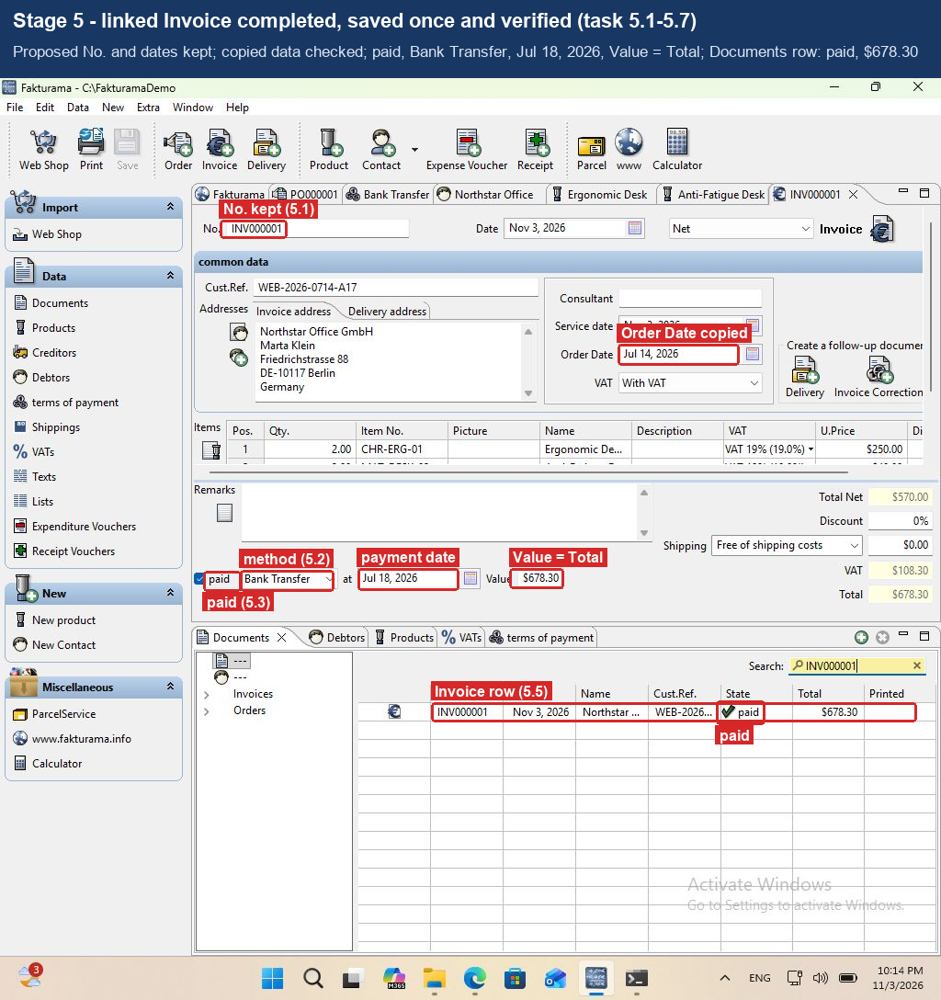

# Fakturama Image-to-Cash Automation

Turns one order image into a saved, verified **Order** and a linked, paid **Invoice** in
[Fakturama](https://www.fakturama.info/download/). It drives Fakturama's own UI with
Microsoft UI Automation, uses OCR for controls UIA cannot see, and uses Claude to read the
image. It never uses fixed screen coordinates.

> **Status:** complete. All five stages run end to end against Fakturama 2.2.0 on
> Windows 11, from an empty workspace and from one that already has the master data. See
> the [demo](#demo), the [known limitations](#known-limitations) and
> [what I would do with 3 more hours](#if-i-had-3-more-hours).

## Demo

**Recording:** [`docs/demo/fakturama_full_run.mp4`](docs/demo/fakturama_full_run.mp4)
(3:21, real time, a caption per stage with the task sections it covers). Fakturama starts
from an **empty workspace**, so this one run goes through every creation branch: payment
method, contact with a separate delivery address, VAT rate and both products. Then it saves
the Order and completes the linked, paid Invoice. Nobody touches Fakturama during the run.

| Stage | Checks | What happened in the recorded run |
|---|---|---|
| 1 Open the New Order | 6 | New Order PO000001 from the toolbar; Date, Cust.Ref., Net, With VAT set and read back |
| 2 Select or create the Debtor | 56 | No contact matched: Bank Transfer created, contact CUST000001 created with invoice and delivery address, saved once, reselected; both order addresses checked |
| 3 Select or create each Product | 69 | VAT 19% (code S) and both products created and reselected; Qty., U.Price and Discount set; Total Net 450.00 after line 1, 570.00 after line 2 |
| 4 Complete and save the Order | 29 | Lines, discount 0%, free shipping and totals 570.00 / 108.30 / 678.30 checked; saved once; one open Order row in Data > Documents; linked Invoice opened from the Order |
| 5 Complete and verify the Invoice | 45 | Copied data checked; Bank Transfer; paid on Jul 18, 2026 with Value 678.30; saved once; Documents: Invoice paid, Order still open |

205 checks, none failed, in about 3 minutes. The run's own report is in
[`docs/demo/run_report/report.md`](docs/demo/run_report/report.md). On a workspace that
already has the contact, payment method, VAT and products, the same image takes the
selection branches instead (101 checks, about 90 seconds). That run also completed with
real Claude reading the image (`python main.py run order.png`, no `--raw`).

The video starts when the run starts and ends 5 seconds after it finishes. Two frames
(0.4 s) where a console window from a status check I ran on the host covered the screen
were dropped; nothing else was cut.

**Annotated screenshots** ([`docs/screenshots/`](docs/screenshots/)), each with the task
sections it shows and the values the run checked:

| # | Screenshot | Shows |
|---|---|---|
| 1 | [input order](docs/screenshots/01_input_order.png) | the order image and the values the flow uses |
| 2 | [stage 1](docs/screenshots/02_stage1_new_order.png) | New Order with the proposed No., Date, Cust.Ref., Net, With VAT |
| 3 | [payment method](docs/screenshots/03_stage2_payment_method.png) | Bank Transfer created and found in Data > terms of payment |
| 4 | [contact addresses](docs/screenshots/04_stage2_contact_addresses.png) | New Debtor: name split, delivery address with the Delivery role |
| 5 | [contact payment](docs/screenshots/05_stage2_contact_payment.png) | Miscellaneous: alias, Net, discount 0%, Bank Transfer |
| 6 | [VAT](docs/screenshots/06_stage3_vat.png) | VAT 19% with code S (Standard rate) |
| 7 | [product](docs/screenshots/07_stage3_product.png) | Product with Price (gross) 297.50 = 250.00 x 1.19 |
| 8 | [lines](docs/screenshots/08_stage3_lines.png) | both lines and the totals 570.00 / 108.30 / 678.30 |
| 9 | [order saved](docs/screenshots/09_stage4_order_saved.png) | saved Order, its open row in Documents, the follow-up Invoice button |
| 10 | [invoice paid](docs/screenshots/10_stage5_invoice_paid.png) | linked Invoice paid on Jul 18, 2026, Value = Total, its paid row in Documents |



## How it works

```
order image ─► extract (Claude → JSON, OCR cross-check, normalize, arithmetic checks)
                  │  validated order (nothing touches Fakturama before this passes)
                  ▼
           flow: 1 open Order → 2 Debtor → 3 Products → 4 save Order → 5 linked Invoice
                  │  each stage ends with a verification gate
                  ▼
           ui driver (locators.yaml: UIA first, label-relative, OCR fallback)  ◄──► Fakturama
                  │
                  ▼
           run report (JSON log, screenshots, manual-review stop)
```

## Project layout

```
.
├── main.py                       CLI: extract | discover | probe | run
├── config/
│   └── locators.yaml             every Fakturama control, found by name, label or container
├── image_to_cash/
│   ├── settings.py               model, timeouts, paths (from .env)
│   ├── errors.py                 ExtractionRejected, ManualReviewRequired, ...
│   ├── numbers.py                exact Decimal money / percentage parsing and rounding
│   ├── ocr.py                    Windows OCR / Apple Vision / Tesseract, words + boxes
│   ├── extract/                  image → validated order (no Fakturama access)
│   │   ├── schema.py             pydantic models of the order
│   │   ├── llm_extractor.py      Claude vision → structured output
│   │   ├── crosscheck.py         critical values must also appear in OCR text
│   │   ├── normalize.py          dates, amounts, percentages, payment method, names
│   │   ├── validate.py           line, net, VAT and gross arithmetic; required fields
│   │   └── pipeline.py           runs the steps above; also loads a saved JSON
│   ├── ui/                       Fakturama driver (Windows; pywinauto imported lazily)
│   │   ├── app.py                connect to / start Fakturama, find controls, screen-level actions
│   │   ├── locators.py           loads and validates config/locators.yaml
│   │   ├── finder.py             resolves a locator in a control tree (live or recorded)
│   │   ├── actions.py            click / type / date / dropdown / checkbox, each read back
│   │   ├── waits.py              wait for a state or a stable value, not for time
│   │   ├── grid_ocr.py           reads Fakturama's custom-drawn tables with OCR
│   │   └── discover.py           records the UIA tree of each screen
│   ├── flow/                     the task's Order-first flow
│   │   ├── runner.py             checks, stage gates, run in order, stop at the first failure
│   │   ├── stages.py             the five stages of the task, in order
│   │   ├── order.py              stage 1: open the New Order (task 1.3–1.8)
│   │   ├── debtor.py             stage 2: find the Debtor in Select the address (2.1–2.4)
│   │   ├── create_debtor.py      stage 2 creation branch: fill in a New Debtor (2.5–2.9)
│   │   ├── payment_method.py     find or create the payment method, select it (2.10)
│   │   ├── products.py           stage 3: select or create each Product, then its line (3.1–3.17)
│   │   ├── vat.py                find or create the VAT rate (3.4–3.6)
│   │   ├── create_product.py     create a missing Product (3.7–3.11)
│   │   ├── lines.py              Qty., U.Price, Discount per line; totals checked after each (3.13–3.16)
│   │   ├── matching.py           exact-match rules for contacts, products, payment methods, VATs
│   │   ├── save_order.py         stage 4: check and save the Order, open the linked Invoice (4.1–4.7)
│   │   ├── documents.py          find and check a row in Data > Documents (4.5, 5.5)
│   │   └── invoice.py            stage 5: check the copied Invoice, payment and paid state, save (5.1–5.7)
│   └── report/
│       └── run_report.py         runs/<time>-<reference>/: report, screenshots, manual review
├── scripts/
│   └── windows_setup.ps1         one-command Windows setup + guided discovery
├── samples/                      the supplied order image, its hand-checked transcription
│                                 (*.raw.json) and the expected validated order (*.expected.json)
├── tests/                        unit tests (run on any OS)
│   ├── fixtures/uia/             slim copies of the recorded Fakturama control trees
│   ├── fixtures/ocr/             OCR of live Fakturama tables
│   └── live/                     live UI tests against a running Fakturama (opt-in)
└── docs/
    ├── demo/                     recording of a full run and that run's report
    ├── screenshots/              annotated screenshots of the same run
    └── design_doc.md / .pdf      the design, condensed to 3 pages
```

## Development setup

The extraction and the unit tests run on any OS. The Fakturama automation needs
**Windows 10/11** with Fakturama installed.

```bash
python -m venv .venv
.venv/bin/pip install -r requirements.txt      # Windows: .venv\Scripts\pip install -r requirements.txt
cp .env.example .env                            # then add your ANTHROPIC_API_KEY
.venv/bin/python -m pytest
```

## Windows setup (to run against Fakturama)

1. **Windows 10 or 11**, on a PC or in a VM. On an Apple-silicon Mac, use
   [UTM](https://mac.getutm.app) (free) or Parallels with Windows 11 on ARM. Set the
   Windows display language to English, because the OCR uses English.
2. **Fakturama.** Download the Windows version from
   <https://www.fakturama.info/download/>, install it, start it once and finish the first-start
   dialog. A new, empty workspace is best for testing (later, File > Select Workspace
   switches to another empty folder; Fakturama restarts). Keep Fakturama's language English:
   the spec and `config/locators.yaml` use the English labels.
3. **Get this project** onto Windows, e.g. to `C:\Fakturama-Task`. Either use GitHub's
   *Code > Download ZIP* and unzip it, or clone it with GitHub Desktop or git.
4. **Run the setup script** in PowerShell from the project folder:

   ```powershell
   cd C:\Fakturama-Task
   powershell -ExecutionPolicy Bypass -File scripts\windows_setup.ps1
   ```

   It installs Python 3.11 x64 with winget if it is missing, creates `.venv`, installs
   `requirements.txt` and runs the tests, including Windows OCR on the sample image. If
   Microsoft's Visual C++ Redistributable (x64) is missing, it installs that too: pywinauto
   needs it, and a new Windows may not have it. Then it waits for Fakturama and starts the
   guided discovery (below). Use `-SkipDiscovery` to stop after the tests.

   The same steps by hand:

   ```powershell
   py -3.11 -m venv .venv
   .venv\Scripts\python -m pip install -r requirements.txt
   .venv\Scripts\python -m pytest
   ```

   Use the **x64** Python 3.11 **on ARM Windows too**: some dependencies (e.g. PyYAML) have
   no ARM64 builds, and Windows runs x64 Python transparently. If the OCR test reports a
   missing language, run this in an administrator PowerShell:
   `Add-WindowsCapability -Online -Name "Language.OCR~~~en-US~0.0.1.0"`. If importing
   pywinauto fails with `DLL load failed while importing win32ui`, install the
   [Visual C++ Redistributable x64](https://aka.ms/vs/17/release/vc_redist.x64.exe).

## Discovering Fakturama's controls (Windows)

`locators.yaml` is built from what UI Automation really exposes, not from guesses. With
Fakturama running:

```powershell
.venv\Scripts\python main.py discover            # guided: one prompt per screen
.venv\Scripts\python main.py discover --list     # what each screen needs open
.venv\Scripts\python main.py discover --only order_editor select_address   # redo some
```

Each prompt says what to open in Fakturama; press Enter to record it. Keep the PowerShell
window next to Fakturama rather than on top of it. The tool is read-only: it brings
Fakturama's windows to the front but never clicks or types. For every window it writes the
control tree (`.tree.txt` / `.tree.json`), a screenshot (`.png`) and the OCR of that
screenshot (`.ocr.json`). At the end it prints the path of a `.zip` with everything.

To check `config/locators.yaml` against the Fakturama that is running now (read-only; it
lists every control it finds on the screens that are open):

```powershell
.venv\Scripts\python main.py probe
.venv\Scripts\python main.py probe --screen order_editor
```

## Running the automation (Windows)

With Fakturama running and no New Order editor open:

```powershell
# Claude reads the image (needs ANTHROPIC_API_KEY in .env)
.venv\Scripts\python main.py run samples\order_WEB-2026-0714-A17.png

# no API key: use the saved transcription, still checked against the image's OCR
.venv\Scripts\python main.py run samples\order_WEB-2026-0714-A17.png --raw samples\order_WEB-2026-0714-A17.raw.json

# skip extraction: use a validated order JSON
.venv\Scripts\python main.py run --from-json samples\order_WEB-2026-0714-A17.expected.json
```

Each stage ends with a check that reads every value back from Fakturama; the run stops at
the first check that fails or the first case that needs a person, and leaves Fakturama as
it is. All five stages are built and live-tested:

- stage 1: open the New Order and set Date, Cust.Ref., Net and With VAT (task 1.3–1.8);
- stage 2: search Select the address and select the one exact contact (Company, First Name,
  Name, ZIP and City), then check the filled-in Invoice and Delivery address (2.1–2.4).
  When none matches: find or create the payment method (2.10.1–2.10.6), fill in a New
  Debtor (2.5–2.9), select the payment method (2.10), save it once (2.11), reselect it in
  the order and check both addresses (2.12–2.13);
- stage 3, for each item in source order: search Select a product by exact SKU and select
  it (3.1–3.3). When missing: find or create the VAT rate, checking Name, Value and VAT code
  S (Standard rate) (3.4–3.6), create the Product with the gross price, save it once and
  select it in the order (3.7–3.12). Then set Qty., U.Price and Discount on its line and
  check that Total Net and VAT equal the completed lines so far (3.13–3.17);
- stage 4: check both addresses, every line (Item No., Name, Qty., U.Price), Discount 0%,
  Free of shipping costs / 0.00 and Total Net, VAT and Total; save once; find the Order in
  Data > Documents (number, Date, Cust.Ref., open, Total); open the linked Invoice from the
  Order's "Create a follow-up document" area, not the toolbar (4.1–4.7);
- stage 5: leave the proposed No., Date and Service date unchanged; check that Cust.Ref.,
  both addresses, Order Date, VAT mode, lines and totals were copied; set or confirm the
  payment method; if PAID tick paid, set the payment date and Value = Total (if not PAID,
  leave paid clear); save once; check the saved payment fields, then the Invoice row (state,
  Total) and the still open Order in Data > Documents. No Delivery, Correction or Dunning
  document is created (5.1–5.7).

Conflicting or ambiguous matches stop for manual review. A completed run leaves the saved
Order and Invoice open in Fakturama.

### Run report and manual review

Every run writes `runs/<date-time>-<reference>/`:

| File | Content |
|---|---|
| `report.md` | readable summary: order, outcome, every check of every stage, screenshot links |
| `report.json` | the same as data, plus the extraction source and warnings |
| `order.json` | the validated order the run used |
| `screenshots/` | Fakturama at the start and after each stage (and where it stopped) |
| `manual_review.json` | only when the run stopped for a person: stage, reason, failed checks, editors left open (unsaved ones marked `*`), the last screenshot and what to do next |

The run never guesses: an ambiguous or conflicting match, a value Fakturama shows
differently from the order, or an unexpected error stops it and leaves Fakturama as it
is. Exit codes: `0` completed, `1` stopped for manual review (or the order was rejected),
`2` wrong platform or options, `3` stopped where the flow is not built yet.

## Live UI tests (Windows)

`tests/live/` drives the real Fakturama and is skipped unless `FAKTURAMA_LIVE=1` is set.
Start Fakturama with no editor open, then:

```powershell
$env:FAKTURAMA_LIVE = "1"; .venv\Scripts\python -m pytest tests/live -v
```

The tests:

- open a New Order, set Cust.Ref., Date and the Net price mode (each read back), open and
  cancel Select the address, close the order **without saving**, and check that the next
  New Order still gets the same number;
- open Data > VATs, read the list with OCR, find the `Tax-free` row, open it by
  double-click and read Name, VAT code and Value from its editor;
- read the column headers of Data > Documents and of the Select the address table.
- run stage 1 for the sample order (from its validated JSON) and close the order unsaved.
- search a contact and a product that do not exist; both selectors must be cancelled.
- fill in a New Debtor for the sample order, check every field, and close it unsaved.
- find the existing Bank Transfer payment method and select it on a New Debtor (skipped when
  it does not exist yet: live tests never save).

Nothing is saved.

## Extracting the order data

```bash
# Claude reads the image (needs ANTHROPIC_API_KEY in .env)
python main.py extract samples/order_WEB-2026-0714-A17.png --out order.json --save-raw order.raw.json

# Same checks without an API key, using a saved transcription
python main.py extract samples/order_WEB-2026-0714-A17.png --raw samples/order_WEB-2026-0714-A17.raw.json
```

The Claude extraction has run live on the sample (Claude Opus 5.5, about 6,800 input and
600 output tokens): its validated order is identical to the hand-checked expected order,
and a full `run` with it completed all five stages. The recorded demo used the saved
transcription (`--raw`) instead; it goes through the same OCR cross-check, normalization
and arithmetic checks as Claude's output.

The validated order goes to stdout (or `--out`); warnings and a one-line summary go to
stderr. Exit code `0` = accepted, `1` = rejected (every problem is listed, and Fakturama is
never touched). The four steps:

| Step | Module | What it does |
|---|---|---|
| A | `llm_extractor.py` | Claude transcribes the image into a fixed schema (structured output). It copies values verbatim and never calculates. |
| B | `crosscheck.py` | Every critical value (reference, dates, SKUs, prices, totals, ZIPs, ...) must also appear in the OCR text, which catches invented values. Percentages allow for Windows OCR reading `%` as `96` or `0/0`. A discount or VAT rate OCR misses entirely is only a warning when OCR found the amounts that fix it, so step D's arithmetic proves it. |
| C | `normalize.py` | Converts to typed values: ISO dates, `Decimal` amounts, known payment methods, first/last name. Ambiguous input (`03/04/2026`, `1,234`, a three-part name) is an error, not a guess. |
| D | `validate.py` | Line totals, net, VAT and gross arithmetic; PAID needs a payment date; the currency must match Fakturama's. |

OCR engine by OS: Windows built-in OCR (Windows), Apple Vision (macOS, for development),
Tesseract if installed.

## Changes from the design doc

- **No `temperature: 0`.** Current Claude models reject the sampling parameters. Repeatable
  output comes from the strict output schema, verbatim-only instructions and the B–D checks.
- **Apple Vision OCR on macOS**, in addition to Windows OCR and Tesseract, so the
  extraction and the OCR cross-check can be developed and tested without Windows.
- **Two schema layers**: a verbatim `Raw*` layer (what Claude returns and OCR is compared
  against) and a typed `OrderData` layer (what the Fakturama flow uses).
- **Payment method before New Contact.** Fakturama 2.2.0 fills a contact's Payment list
  when the contact editor opens, so the method (task 2.10.1–2.10.6) is found or created
  before New Contact (2.5) and then selected (2.10). The result is the same.
- **A read-back mismatch stops the run** at once instead of re-entering the value once:
  a field that does not take a value usually means a wrong control or a Fakturama rule,
  and a retry would hide that.
- **OCR is the main way to read Fakturama's lists**, not only a fallback: the lists are
  drawn by Fakturama itself, so UI Automation sees no rows. The vision-LLM locator of last
  resort was not built; UIA and OCR covered every control the flow needs.
- **No duplicate-order guard yet** (see [3 more hours](#if-i-had-3-more-hours)).
- **Empty strings instead of nulls in the schema sent to Claude.** With 36 optional text
  fields, the API rejected the structured-output schema ("compiled grammar is too large").
  Claude now gets a copy of the schema in which every text field is required and an empty
  string means "not printed"; the answer is turned back into `None` values before the
  checks, so everything after the extraction is unchanged.

## Fakturama 2.2.0 notes (found while building the UI driver)

- The contact's payment method is on the **Miscellaneous** tab; 2.2.0 has no separate
  Payment tab (task step 2.10).
- In **Net** price mode the order's "Total Gross" field becomes "Total Net".
- Fakturama shows amounts with `$` and dates as `Jul 14, 2026` (as in the task's own
  screenshots). Amounts are compared as numbers; the order currency (EUR) is checked against
  `EXPECTED_CURRENCY`, not against Fakturama's display.
- The Date field is a segmented date editor: typing `Jul 14, 2026` only changes the day.
  It is set by typing month, day and year as digits, then read back.
- Closing a changed editor opens a **Save Parts** list with a tick box, not a Yes/No
  question. To discard, the tool unticks the row with Space, confirms through the list
  control that nothing is ticked, then presses OK. Any other dialog is cancelled and the
  run stops for manual review.
- Payment-code names end with a space (`'Credit transfer '`); names are compared with
  surrounding spaces ignored.
- The lists (products, contacts, VATs, documents) are drawn by Fakturama itself, so UI
  Automation sees no rows. They are read with OCR: the table area (found through UIA) is
  captured, read at 2x, words are grouped into rows and put under the column whose header
  starts at or before them. In a selected row the white column lines read as `I`/`|`;
  those tokens are dropped. A row is clicked at the position OCR found for it, and every
  selection is confirmed by its effect (the editor or the address it fills in).
- The list tabs (VATs, Documents, ...) do not support UI Automation's Select; the tool
  clicks them instead and checks that they became selected.
- An existing record opens in an editor tab named after it (e.g. `Tax-free`). The
  standard VAT cannot be deleted (its delete button stays disabled).
- An address gets its role (Invoice address / Delivery address) from tick boxes in a popup
  behind the small arrow next to "address type". `+` adds an "additional address #1"
  tab; only the open address tab's fields are visible to UI Automation.
- A delivery address whose name differs from the company (the sample's "Northstar Office
  Warehouse") goes into that address's "additional name"; the billing address name equals
  the company, so its additional name stays empty (task 2.7: only when supplied).
- Only the active editor's content is in the UIA tree; a background editor is just a tab.
  The tool tells "open" (a tab exists) from "active" and brings the right tab to the front.
- The contact's Payment list is filled when the contact editor opens; a payment method
  saved while a New Debtor is open is not offered there. So the tool resolves the payment
  method (task 2.10.1–2.10.6) **before** opening New Contact (2.5), then selects it (2.10):
  same result as the task's order, which does not work in 2.2.0.
- The contact's Payment list shows a payment method's Description (`Pay Cash`), not its
  Name (`Cash`); the task sets both to the method name, so both match.
- Setting UIA focus on a field in an inactive list panel does not move the keyboard focus.
  Before typing, the tool checks that the field really has the keyboard focus (clicking
  into it if needed) and refuses to type otherwise.
- Select a product and Select the address pick a row **by themselves** as soon as the
  search leaves one row. Typing character by character could therefore pick a product that
  only matches the first letters. The tool sets the whole search text in one step (UIA
  ValuePattern) and, when the selector closes itself, checks the result (the new line's
  SKU, or the filled-in addresses) like any other selection.
- In Select the address the column headers are centred, in the other lists left-aligned.
  Cells are assigned to columns using the table's vertical grid lines found in the header
  row (pixel analysis), with the header positions as fallback. OCR reads the cut-off mark
  "…" as `• .. .`; such cells count only as a prefix match.
- The order's item table is wider than the editor; Discount is reached by scrolling the
  editor (its own scrollbar) and the editor is always scrolled back afterwards. Clicking a
  cell's value opens an inline editor (a real UIA Edit), which is filled like any field;
  Enter moves the editor down a line, so Escape follows. Its header is low-contrast, so an
  extra OCR pass reads the header row with boosted contrast at 3x.
- Fakturama prints the contact's company, not an address's "additional name", in the
  order's Delivery address; that line passes when it shows the delivery name or the
  company. Street, ZIP and City must match exactly.
- Data > Documents remembers the filter chosen in its tree across restarts (for example
  "Invoices/unpaid"), which hides a new Order, and after a document is opened from the list
  its first items show "This transaction" and the contact instead of `---`. Before every
  search the tool selects the Orders or Invoices item, which lists every document of that
  kind in both cases.
- If Fakturama warns about a duplicate contact while one is being created, the run stops
  for manual review (nothing is saved).
- Data > Documents is a list panel: setting its search text through UIA does not filter, so
  the tool types it (and reads it back). Its Total column renders `$678.30` so that OCR
  reads `"78.30`; a cell that does not read as the expected value is cropped from the table
  (using the column lines), turned black and white and read again at 3x before it counts
  as a mismatch. Inside a money column OCR's `S` for `$` and `o` for `0` are accepted; any
  other misreading fails.
- The Order and Invoice editors are split: header and items in an upper part with its own
  scrollbar, Remarks and totals below. In the Invoice the items table does not fit, so the
  tool scrolls that part until the whole table is visible, reads the lines and scrolls back.
  The low-contrast "Qty." header is sometimes missed; the quantity is then read as the
  number left of the line's Item No. (as when the line is filled in).
- Ticking the Invoice's **paid** box adds an "at" date and a Value field; the tool waits for
  them before setting the payment date and the full Total.
- After saving, an editor tab is named after its document (`PO000002`, `INV000002`); the
  tool checks the saved values in that tab.
- Editors are closed with File > Close after clicking their tab (Ctrl+W is swallowed when a
  dropdown has the focus). Menu entries carry their shortcut when an editor is active
  (`Close\tCtrl+W`), so menu locators accept that suffix.

## Known limitations

- Run live on the one sample image, both from an empty workspace and with existing master
  data. The other branches (an unpaid order, identical billing and delivery address,
  ambiguous or conflicting contacts, products, VATs and payment methods) are covered by
  unit tests against a simulated Fakturama, not live.
- The Claude extraction has run live on the sample image only (see
  [Extracting the order data](#extracting-the-order-data)); the recorded demo used the saved
  transcription.
- The same image can be booked twice: master data is reused, but a second run creates a
  second Order and Invoice.
- English Fakturama UI and English Windows OCR; dates shown as `Jul 14, 2026`. Fakturama
  shows `$` (its locale) while the order is in EUR; amounts are compared as numbers and
  the order currency is checked against `EXPECTED_CURRENCY`.
- Reading Fakturama's lists with OCR is the slowest part and needs re-reads of single
  cells (cropped, black and white, 3x). A run takes about 90 seconds with existing master
  data and about 3 minutes from an empty workspace.
- The saved Order, Invoice and created records stay open as editor tabs after a run.

## If I had 3 more hours

In order of value:

1. **Stop a second booking of the same image (30 min).** Before stage 1, search Data >
   Documents for the Cust.Ref. and stop for review when an Order with it exists. The
   design doc planned this; testing booked the sample twice.
2. **Measure the Claude extraction on more images (45 min).** It has run live on the
   sample with the same result as the hand-checked transcription. Run it on 5–10 variants
   (photo, skew, low resolution, a second VAT rate, an unpaid order, a SEPA payment), record
   which check catches which error, and add the variants as test fixtures.
3. **Run the remaining branches live (60 min).** The unpaid path, one address with both
   roles, a near-duplicate contact (Fakturama's duplicate warning already stops the run),
   and a VAT or product that exists with conflicting values. Record each as a live test.
4. **Resume after a stop (30 min).** A stop leaves the unsaved Order open for a person. A
   `--resume` option could discard it the same safe way (untick in Save Parts) and run
   again; master data saved before the stop is already found and reused.
5. **Make runs faster (15 min).** Remember each table's column layout after the first
   read and read only the row that is needed. Close the master-data editors after saving
   so the next screens need fewer UI Automation lookups.

## Progress

| # | Step | Status |
|---|---|---|
| 1 | Repo structure, dependencies, sample image | done |
| 2 | Extraction: schema, Claude call, OCR cross-check, normalize, validate | done; the Claude call ran live on the sample with the same result as the hand-checked transcription |
| 3 | UIA discovery on Windows | done: all 13 screens recorded from Fakturama 2.2.0 on Windows 11 |
| 4 | UI helpers and `locators.yaml` | done: locators and finder, connect and waits, actions with read-back, table OCR; 5 live tests pass. Editing item-line cells moves to step 6 (needs a product line) |
| 5 | Stage 1: open New Order | done: `main.py run` runs it from the image or JSON; live-tested |
| 6 | Stages 2–3: select existing Debtor and Products, fill item lines | done: existing contact and products selected live; item lines completed with totals checked |
| 7 | Stages 4–5: save Order, linked Invoice, paid status, verification | done and live-tested: a full `main.py run` from the image completed all five stages (PO000002 saved and open, INV000002 saved as paid on Jul 18, 2026 for $678.30) |
| 8 | Create missing Debtor, Payment Method, VAT, Product | done and live-tested: contact (with delivery address), Bank Transfer, VAT 19% and both products created, saved once and reselected |
| 9 | Run report and manual-review stops | done: report folder with checks and screenshots per stage, `manual_review.json` on every stop; live-tested |
| 10 | README, screenshots / recording, written answers | done: recording and annotated screenshots of a full run from an empty workspace, known limitations, the "3 more hours" answer, design doc condensed to [`docs/design_doc.md`](docs/design_doc.md) |
